<p align="center">
  
</p>

# 🧭 EH3D-STUDIO

<p align="center"><a href="README.md">🇺🇸 English</a> | <a href="README_spa.md">🇪🇸 Español</a> | <a href="README_fra.md">🇫🇷 Français</a> | 🇮🇹 <b>Italiano</b> | <a href="README_deu.md">🇩🇪 Deutsch</a> | <a href="README_zho.md">🇨🇳 中文</a> | <a href="README_jpn.md">🇯🇵 日本語</a> | <a href="README_por.md">🇵🇹 Português</a></p>

### Il pannello di configurazione del server EH3D: le macchine e le loro stazioni, i lavori, gli utenti e i token dei programmi, tutto strutturato e con l'aspetto di BUNGARD-GUI, in otto lingue.

<p align="center">
  
  
  
  
  
</p>

---

**Verifica di onestà - cosa gira oggi:** un'applicazione web in React e TypeScript che accede a EH3D-SERVER e mostra e modifica ciò che contiene: le macchine con la loro stazione, il loro nodo e i file di configurazione, i lavori, gli utenti e i token, gli eventi in tempo reale. Il client dell'API, le regole dei moduli, il menu per ruolo e le otto lingue sono coperti da 46 test, e le pagine sono state viste in un browser contro un server locale con macchine simulate. **Non è stata usata con macchine su un banco di prova**, e il server non termina ancora TLS.

---

> **Stato di sicurezza (safety) e di sicurezza informatica:** questo non è un sistema di sicurezza (safety). Studio modifica ciò che conserva un server che muove macchine: un indirizzo o un token di nodo sbagliati, una stazione errata o una macchina eliminata possono fermare un'officina o indirizzare un lavoro alla macchina sbagliata, e un token creato qui permette a un programma di inviare lavori. Il server controlla il ruolo della persona a ogni richiesta; nascondere un pulsante è solo una comodità. Su una rete non cifrata il token viaggia in chiaro (il server non termina ancora TLS): usalo sulla rete di casa o tramite VPN. Il progetto è indipendente: non è realizzato, approvato né supportato da Bungard Elektronik.

## 📋 In breve

| | |
|---|---|
| Versione | `0.0.1` |
| Maturità | Impalcatura |
| Test | 46 test (`npm test`) |
| Stack tecnologico | React 19, TypeScript, Vite |
| Su hardware reale | Non con macchine su un banco: vista in un browser contro un server locale con macchine simulate |

**Vai a:** [Panoramica](#-panoramica) · [Architettura](#-architettura) · [Avvio rapido](#-avvio-rapido) · [Test](#-test) · [Struttura](#-struttura-del-repository) · [Correlati](#-progetti-correlati)

## 🚦 Stato del progetto

Ogni riga è una parte di questo repository e il semaforo dice a che punto è oggi. È scritta in base a ciò che il repository può mostrare (test, compilazioni, esecuzioni), non a ciò che è previsto.

🟢 Fatto e verificato · 🟡 Funziona, con limiti noti · 🟠 Fatto a metà o non ancora verificato · 🔴 Non fatto o non funzionante

| Area | Stato | Cosa significa qui |
|---|---|---|
| Software | 🟡 | L'applicazione compila senza avvisi (tipi, lint, build) ed è servita dal server alla radice del suo indirizzo; è stata eseguita in un browser contro un server locale. |
| Test | 🟢 | 46 test passano (`npm test`): il client dell'API con i suoi errori, le regole di nomi, password e indirizzi, il menu per ruolo, la flotta per stazione, le azioni di un lavoro e le otto lingue. |
| Pagine | 🟡 | Panoramica, macchine per stazione, lavori, eventi in tempo reale, macchine, utenti e token, server, account, preferenze e informazioni sono scritti; lavori e macchine si gestiscono con l'API reale del server. Nessuna pagina è stata provata da qualcuno che non sia l'autore. |
| Lingue | 🟢 | Otto lingue in ogni testo, compresi i rifiuti del server; i testi sono letti da un test, ma solo l'inglese e poche frasi delle altre sono state lette da una persona. |
| Macchine reali | 🔴 | Nulla è stato fatto su un banco: nessuna macchina aggiunta, nessun nodo raggiunto e nessun lavoro eseguito tramite essa su una macchina reale. |
| Documentazione | 🟢 | README in otto lingue, le impostazioni del server e come mettere Studio sulla CM5. |

## 🎯 Panoramica

* **Monitoraggio:** la panoramica (macchine libere, in esecuzione e in attesa, lavori pronti, attivi, terminati e falliti), le macchine sotto le loro stazioni con l'avanzamento di ogni lavoro, l'elenco dei lavori con filtri e azioni, e gli eventi in tempo reale del server tramite il suo websocket.
* **Configurazione:** le macchine (identificatore, nome, modello, stazione, un nodo con indirizzo e token o il simulatore, il testo dei due file di configurazione e il file di macchina), gli utenti con il loro ruolo, i token dei programmi e il riferimento delle impostazioni del server.
* **Account:** la password della persona, la lingua, il tema e ogni quanto le pagine interrogano di nuovo il server.
* **L'aspetto di BUNGARD-GUI:** il tema Forge di default (nero caldo, ambra, schede con due angoli tagliati, pulsanti con bordo ambra) e altri tre: Carta, Neon e Mezzanotte.
* **Servito dal server:** con `studio_dir` in `server.cfg` il server serve queste pagine alla radice del proprio indirizzo, quindi non c'è altro da installare né impostazioni di origine incrociata.

## 🧩 Ruolo in EH3D

EH3D-STUDIO sta a EH3D-SERVER come ARMOR-STUDIO sta al server di ARMOR: l'unico posto dove si configura e si segue tutto ciò che il server conserva, strutturato e classificato. I programmi (EH3D-DRILLPRO, EH3D-ROUTEPRO, EH3D-BUNGARD-GUI, lo schermo touch della macchina) usano i token creati qui e le macchine definite qui; le macchine si raggiungono tramite i loro nodi.

## 🏛️ Architettura

<p align="center">
  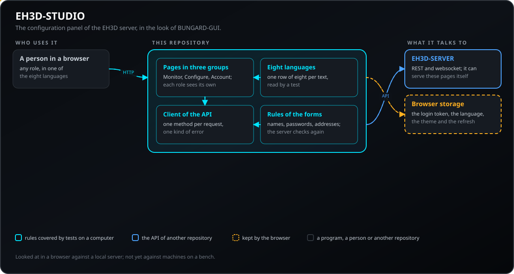
</p>

Come si incastrano le parti di questo repository: chi parla con esso, cosa contiene e da cosa dipende. Il disegno nasce da `docs/architecture.json` ed è verificato sul codice.

## 🖼️ Schermate

<p align="center">
  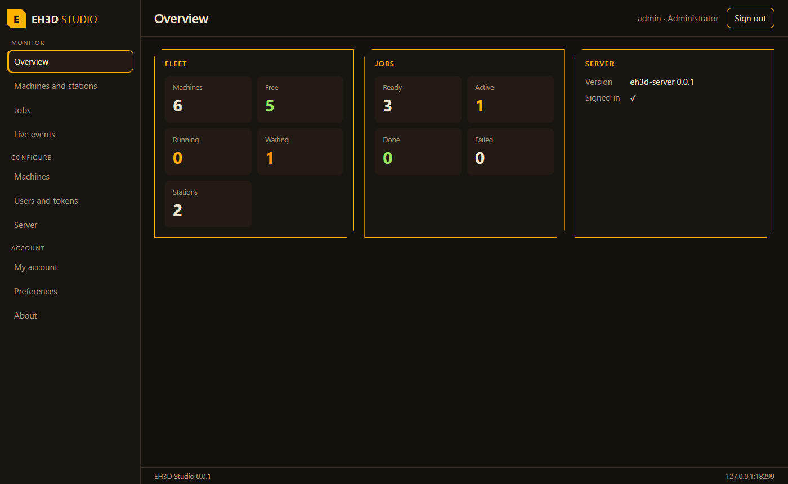
</p>

<p align="center"><em>La panoramica: macchine libere, in esecuzione e in attesa, e i lavori per stato.</em></p>

<p align="center">
  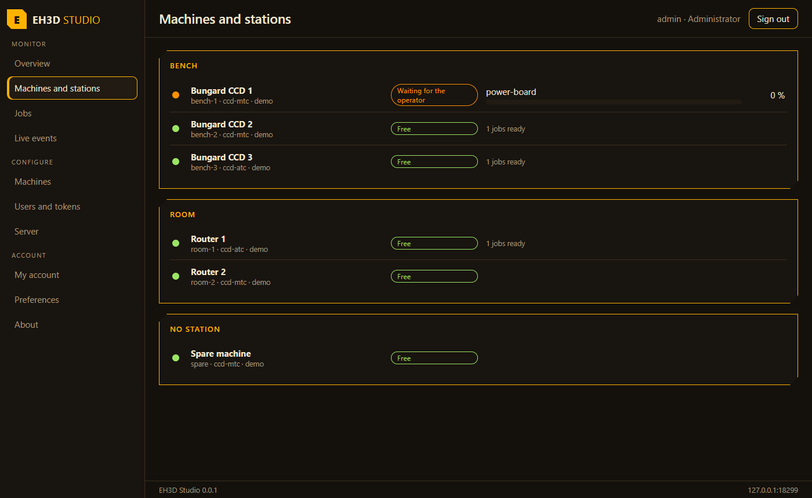
</p>

<p align="center"><em>Le macchine sotto le loro stazioni, con lo stato e l'avanzamento di ogni lavoro.</em></p>

<p align="center">
  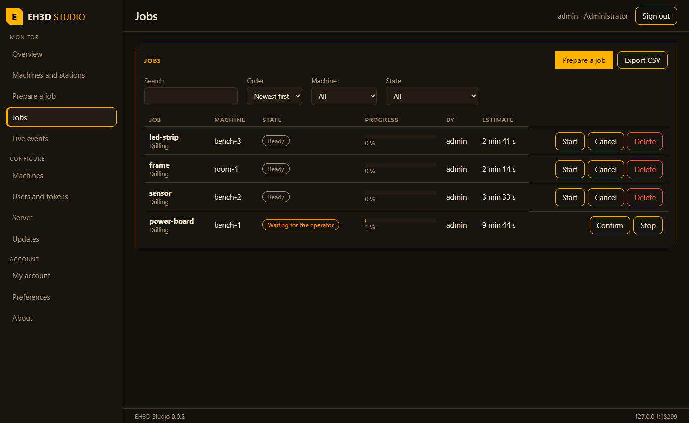
</p>

<p align="center"><em>I lavori con i filtri e le azioni che il ruolo consente.</em></p>

<p align="center">
  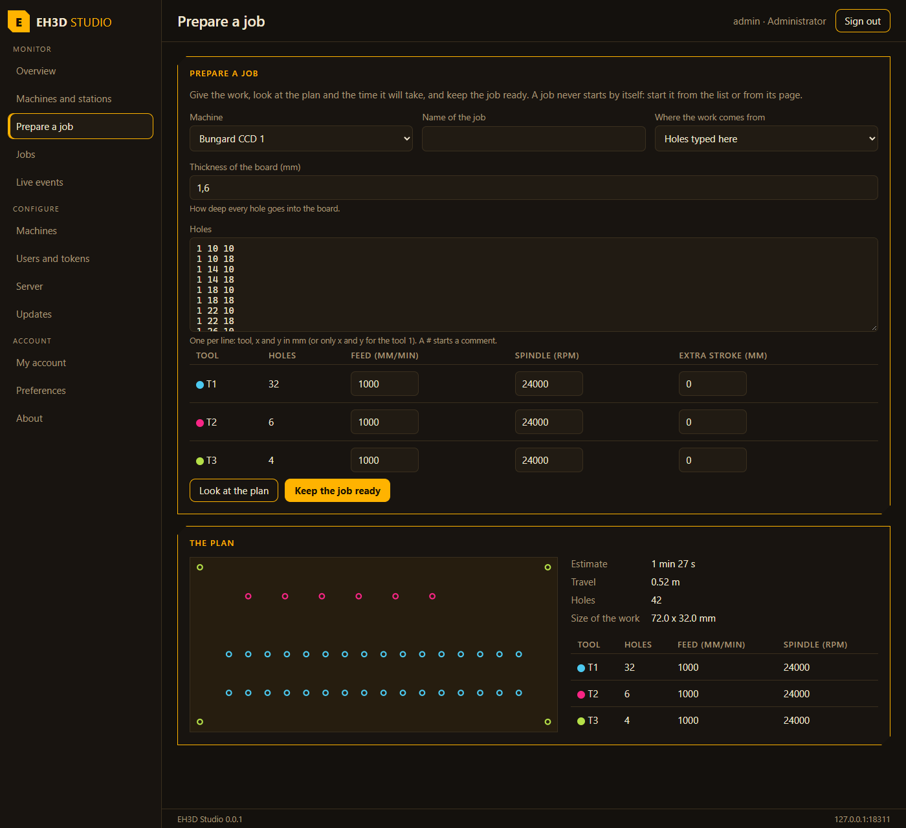
</p>

<p align="center"><em>Preparare un lavoro: il lavoro scritto, il disegno e il tempo calcolato dal server.</em></p>

<p align="center">
  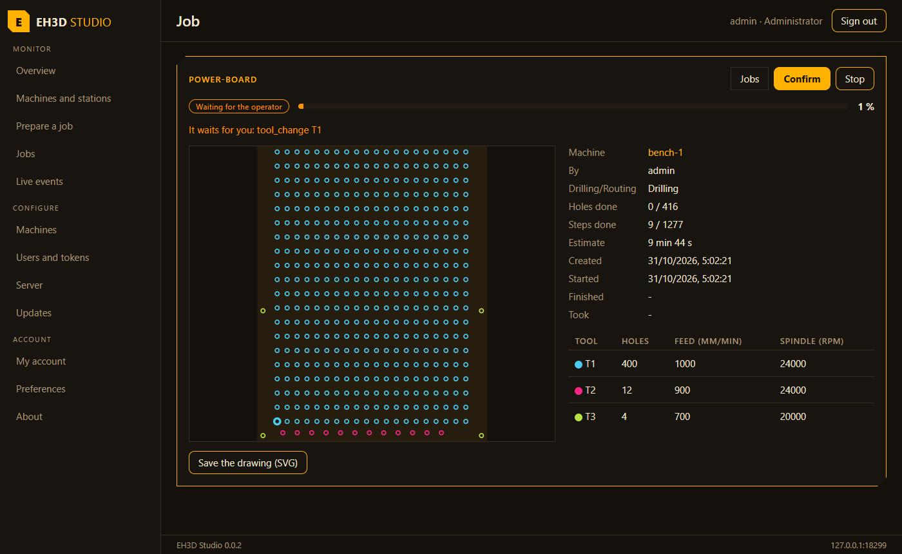
</p>

<p align="center"><em>Un lavoro: il disegno con i fori già fatti, a che punto è e i pulsanti del suo stato.</em></p>

<p align="center">
  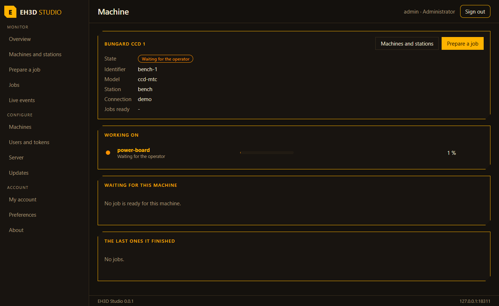
</p>

<p align="center"><em>Una macchina: cosa fa, cosa la aspetta e gli ultimi lavori che ha finito.</em></p>

<p align="center">
  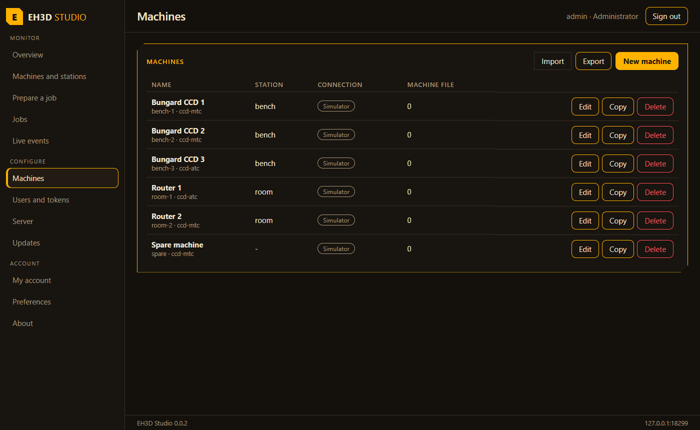
</p>

<p align="center"><em>Le macchine del server: stazione, nodo e file di configurazione.</em></p>

<p align="center">
  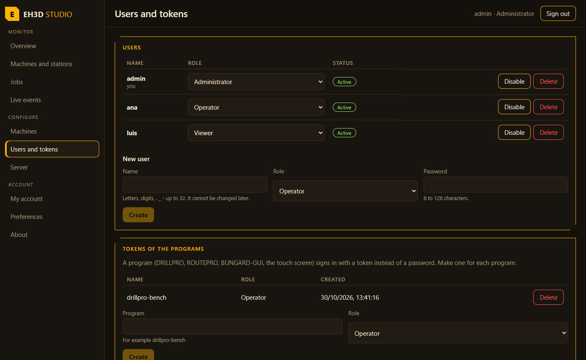
</p>

<p align="center"><em>Gli utenti con il loro ruolo, e i token dei programmi.</em></p>

<p align="center">
  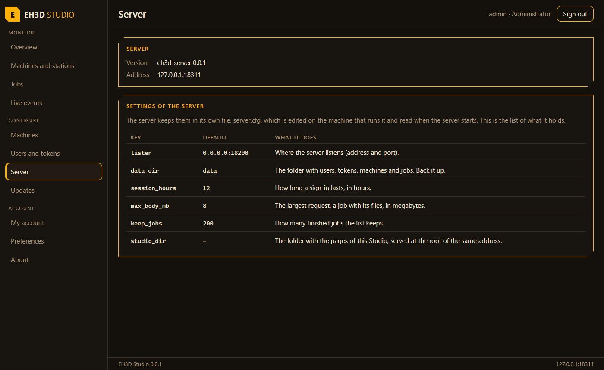
</p>

<p align="center"><em>Le impostazioni del server, come riferimento.</em></p>

<p align="center">
  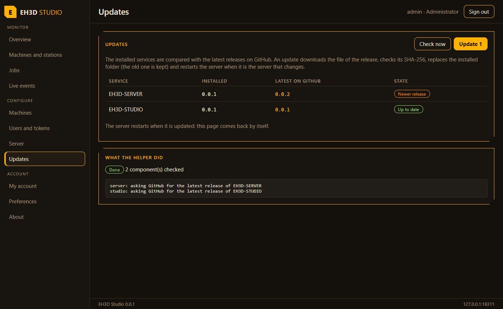
</p>

<p align="center"><em>La pagina Aggiornamenti: ciò che è installato, l'ultima release su GitHub e cosa ha fatto l'helper del server.</em></p>

<p align="center">
  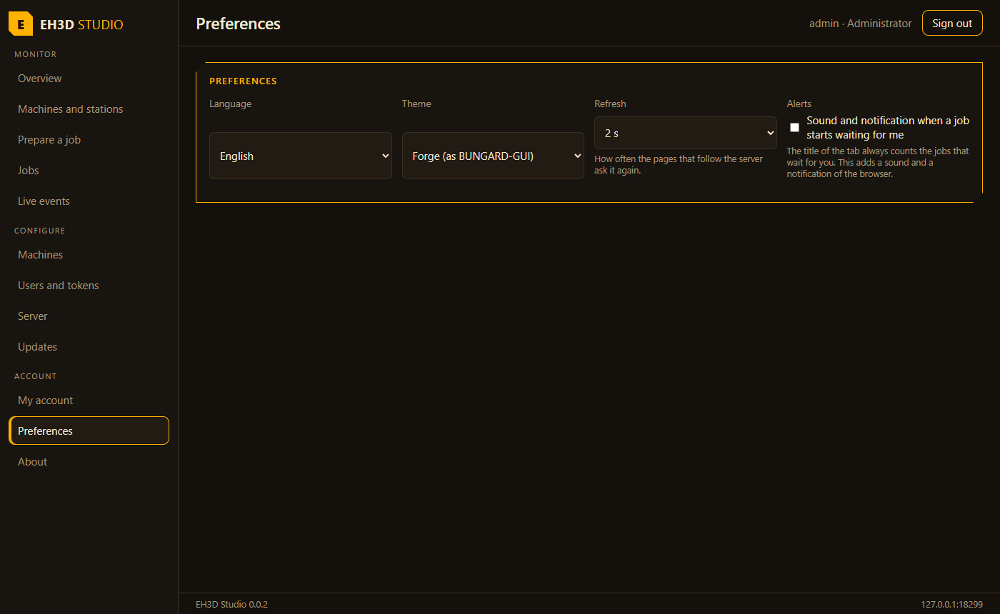
</p>

<p align="center"><em>Le preferenze: lingua, tema e aggiornamento.</em></p>

## ✨ Funzionalità

* **Ogni ruolo vede il suo menu:** un osservatore vede le pagine di Monitoraggio, la pagina del Server e quelle dell'Account; un amministratore vede anche Macchine e Utenti e token.
* **Controlli prima dell'invio:** nomi, password e indirizzi dei nodi sono controllati nel modulo, e il rifiuto del server è mostrato come frase nella lingua della persona.
* **Token mostrati una volta:** il token di un programma appare alla creazione e non si vede più; il token di un nodo non viene mai mostrato dopo il salvataggio.
* **Segue il server:** flotta e lavori si aggiornano da soli (o solo a richiesta), e la pagina in tempo reale si riconnette quando il collegamento cade.
* **Aggiornamenti:** una pagina per l'amministratore confronta il server e Studio installati con le ultime release su GitHub, controlla quando richiesto e aggiorna ciò che è più nuovo, mostrando cosa fa l'helper del server mentre lavora; quando il server stesso si riavvia, la pagina torna da sola. L'aggiornamento richiede `updates_dir` in `server.cfg` e l'helper di EH3D-SERVER installato; è stato provato con simulazioni di GitHub e systemd, mai su un'installazione reale.
* **Preparare un lavoro qui:** scegli la macchina e dai il lavoro come i file che leggono i programmi (`.NCD` con il suo `.DTD`, `.PLT` con il suo `.RTD`) oppure come fori scritti a mano (utensile, x e y, con avanzamento, velocità e corsa extra di ogni utensile); guarda il disegno, il tempo e il percorso che calcola il server e lascia il lavoro pronto. Un lavoro non parte mai da solo.
* **Una pagina per ogni lavoro:** il disegno con i fori già fatti riempiti e il prossimo cerchiato, a che punto è, chi l'ha fatto e quando, gli utensili e i pulsanti adatti al suo stato (avvia, conferma, ferma, elimina). I lavori che aspettano l'operatore sono in alto nella panoramica con il loro pulsante Conferma.
* **Un elenco con cui si può lavorare:** ricerca per nome, macchina, persona o stato, cinque ordinamenti, un CSV di ciò che si vede e un pulsante che rimuove i lavori terminati; la panoramica somma ciò che hanno fatto le macchine (lavori, fori, ore).
* **Avvisi:** il titolo della scheda conta i lavori che aspettano l'operatore e, se la persona lo attiva, un suono e una notifica del browser avvisano quando uno nuovo inizia ad aspettare.
* **Le macchine passano da un server all'altro:** ogni macchina si può copiare e le macchine di un server si possono esportare in un file e importare in un altro (i token di accesso dei nodi non vengono mai esportati).
* **Una pagina per ogni macchina, copie e server caduto:** la pagina di una macchina mostra cosa fa, i lavori che la aspettano con il loro tempo totale e gli ultimi che ha finito; un lavoro può essere lasciato pronto in più copie insieme (la stessa scheda molte volte); il disegno di un piano si salva come SVG; e una riga rossa avvisa quando il server smette di rispondere, finché non risponde di nuovo.

## 🔒 Sicurezza e protezione

| Minaccia | Difesa |
|---|---|
| Qualcuno che non ha effettuato l'accesso | ogni pagina richiede un accesso; il server rifiuta ogni richiesta senza un token valido (`401`), e cinque password errate bloccano il nome per un po' |
| Una persona che fa più di quanto il suo ruolo consente | il menu e i pulsanti seguono il ruolo, e il server ricontrolla il ruolo a ogni richiesta |
| Un token letto da altri | il token di un programma si mostra una volta, quello di un nodo mai più; il token di accesso vive solo nel browser della persona e va solo al server da cui è venuta la pagina |
| Un valore errato inviato al server | nomi, password e indirizzi sono controllati prima dell'invio, e il server li ricontrolla e rifiuta una configurazione con una chiave inesistente |

**Ciò che non è difeso:** il server non termina ancora TLS, quindi su una rete non cifrata token e password viaggiano in chiaro; un browser che un'altra persona può usare resta con l'accesso aperto finché la persona non esce o l'accesso scade (12 ore di default). Studio non ha avuto una revisione indipendente, e i controlli di un modulo sono una comodità: ci si fida solo del server.

## 🔌 Interfacce

| Interfaccia | Che cos'è | Dove |
|---|---|---|
| API REST | tutto ciò che le pagine mostrano e modificano passa per `/api/v1/` di EH3D-SERVER, con il token di accesso come bearer token | `src/api.ts` |
| Websocket | `/api/v1/events?token=...` per la pagina in tempo reale, con una riconnessione che attende più a lungo ogni volta | `src/pages/Monitor.tsx` |
| Archivio del browser | il token di accesso, la lingua, il tema e l'aggiornamento, sotto `eh3d-studio.*` | `src/App.tsx` |

## ⚙️ Configurazione

Studio non ha un file di impostazioni proprio: le impostazioni del server sono nel suo `server.cfg` (la pagina Server le elenca), e ciò che sceglie una persona viene conservato nel suo browser.

| Impostazione | Default | Intervallo | Cosa fa |
|---|---|---|---|
| `studio_dir` | none | a folder | nel `server.cfg` del server: serve le pagine di questa cartella alla sua radice |
| `EH3D_SERVER` | `http://127.0.0.1:18200` | a URL | in sviluppo (`run.sh`): il server con cui parlano le pagine |
| `eh3d-studio.lang` | the browser's | `en es it de fr pt zh ja` | la lingua della pagina |
| `eh3d-studio.theme` | `forge` | `forge paper neon midnight` | il tema della pagina |
| `eh3d-studio.refresh` | 5 | 0, 2, 5, 10, 30 | secondi tra due letture del server (0: solo a richiesta) |

## 🚀 Avvio rapido

Serve Node 22 o più recente. Per usare Studio sulla CM5, compila le pagine e indica al server dove sono.

```bash
build.bat            # install and build the pages into dist/  -  ./build.sh on Linux
test.bat             # type check, lint and tests
python -I tools/ci_validate.py
```

Copia `dist/` sulla CM5 (ad esempio in `/opt/eh3d-studio`), metti `studio_dir = /opt/eh3d-studio` nel `server.cfg` del server e riavvialo: Studio si apre all'indirizzo del server, ad esempio `http://cm5:18200/`. La prima volta la pagina chiede il codice di configurazione che il server stampa sulla console e crea l'amministratore.

## 🧪 Test

`npm test` esegue 46 test e passano tutti: il client dell'API (il token, il corpo, la query, gli errori, una rete che fallisce, i percorsi con nomi da proteggere), le regole di nomi, password e indirizzi dei nodi, cosa non va in una macchina, il menu di ogni ruolo, le macchine raggruppate per stazione, i conteggi e le azioni di un lavoro, e le otto lingue (un testo in ogni lingua, cinese e giapponese nella loro scrittura, gli stessi segnaposto ovunque). Passano anche `npm run typecheck` e `npm run lint`.

## 🏗️ Compilazione e rilascio

La versione vive in `package.json` e in `eh3d.project.json`, e ogni versione ha la sua voce in [CHANGELOG.md](CHANGELOG.md). `build.sh` / `build.bat` installano il necessario la prima volta e compilano le pagine in `dist/`; `test.sh` / `test.bat` eseguono il controllo dei tipi, il lint e i test; `run.sh` / `run.bat` aprono Studio in sviluppo contro un server (`run.sh http://cm5:18200`).

## 🩺 Risoluzione dei problemi

| Sintomo | Cosa fare |
|---|---|
| La pagina dice che il server non risponde | Apri `http://INDIRIZZO/api/v1/health` nel browser: deve rispondere `eh3d-server` e una versione. Se Studio è servito dal server, l'indirizzo della pagina è quello del server. |
| La pagina chiede un codice di configurazione | Il server non ha ancora utenti: il codice è sulla sua console (sulla CM5: `journalctl -u eh3d-server`). |
| Una pagina che mi serve non è nel menu | Il menu segue il ruolo: macchine e utenti e token sono per gli amministratori. |
| Il salvataggio di una macchina è rifiutato con un errore di configurazione | Il file di macchina ha una chiave inesistente o un valore fuori intervallo; il server lo rifiuta invece di ignorarlo. |

## 📂 Struttura del repository

<p align="center">
  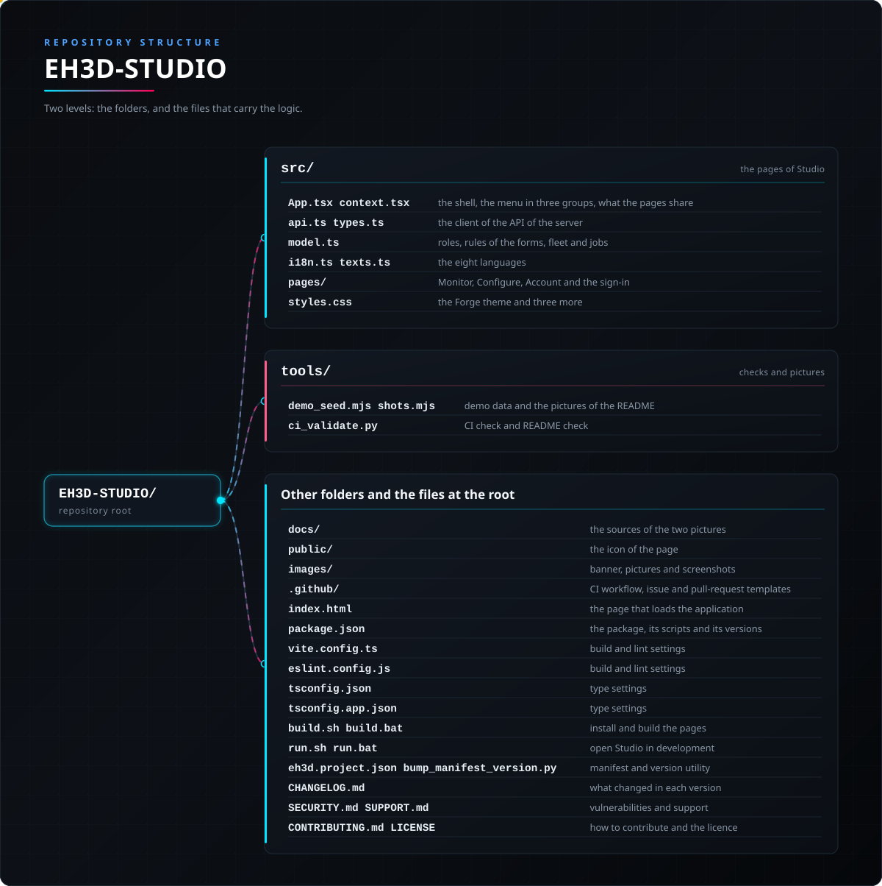
</p>

<details>
<summary>Versione testuale dell'albero</summary>

```text
EH3D-STUDIO/
├── src/
│   ├── App.tsx context.tsx                      la struttura, il menu in tre gruppi, ciò che condividono le pagine
│   ├── api.ts types.ts                          il client dell'API del server
│   ├── model.ts                                 ruoli, regole dei moduli, flotta e lavori
│   ├── jobtools.ts attention.ts                 gli strumenti dei lavori: fori, richieste, disegno, ricerca, CSV
│   ├── i18n.ts texts.ts                         le otto lingue
│   ├── pages/                                   Monitoraggio, Configurazione, Account e accesso
│   └── styles.css                               il tema Forge e altri tre
├── tools/
│   ├── demo_seed.mjs shots.mjs                  dati dimostrativi e le immagini del README
│   └── ci_validate.py                           controllo CI e README
├── docs/                                        le fonti dei due disegni
├── public/                                      l'icona della pagina
├── images/                                      banner, disegni e schermate
├── .github/                                     workflow CI e modelli
├── index.html                                   la pagina che carica l'applicazione
├── package.json                                 il pacchetto, i suoi script e le versioni
├── vite.config.ts                               impostazioni di build e lint
├── eslint.config.js                             impostazioni di build e lint
├── tsconfig.json                                impostazioni dei tipi
├── tsconfig.app.json                            impostazioni dei tipi
├── build.sh build.bat                           installare e compilare le pagine
├── run.sh run.bat                               aprire Studio in sviluppo
├── eh3d.project.json bump_manifest_version.py   manifesto e utilità di versione
├── CHANGELOG.md                                 cosa è cambiato in ogni versione
├── SECURITY.md SUPPORT.md                       vulnerabilità e supporto
└── CONTRIBUTING.md CODE_OF_CONDUCT.md LICENSE   come contribuire e la licenza
```

</details>

## 🗺️ Roadmap e limiti noti

**Limiti noti oggi**

* Non è stata usata con macchine su un banco: nessuna macchina di un'officina è stata configurata tramite essa e nessun lavoro è stato eseguito da essa su una macchina reale.
* Il server non termina TLS, quindi token e password viaggiano in chiaro su una rete non cifrata.
* Le impostazioni del server sono mostrate come riferimento, non modificate: l'API non le fornisce, e si cambiano in `server.cfg` sulla macchina che esegue il server.
* Solo il proprietario ha guardato le pagine; i testi delle lingue diverse dall'inglese non sono stati letti da madrelingua.
* Non c'è ancora una pagina del visore di un lavoro (la pianta dei fori).

**Prossimi passi**

* Provarla con le macchine di un banco: aggiungere ogni macchina, raggiungere il suo nodo ed eseguire un lavoro dalla pagina dei lavori.
* Una pagina per vedere un lavoro (la pianta dei fori e a che punto è).
* Terminare TLS nel server, o documentare un reverse proxy, e mostrare lo stato della connessione.
* Modificare le impostazioni del server da Studio quando il server le fornisce.

## 🌍 Lingue

Il README e i testi esistono in inglese, spagnolo, francese, italiano, tedesco, cinese, giapponese e portoghese europeo.

## 🔗 Progetti correlati

* [EH3D-SERVER](https://github.com/JuanenRac/EH3D-SERVER): il server che questo pannello configura
* [EH3D-DRILLPRO](https://github.com/JuanenRac/EH3D-DRILLPRO): il programma di foratura, client del server
* [EH3D-ROUTEPRO](https://github.com/JuanenRac/EH3D-ROUTEPRO): il programma di fresatura, client del server
* [EH3D-BUNGARD-GUI](https://github.com/JuanenRac/EH3D-BUNGARD-GUI): l'interfaccia moderna delle macchine Bungard, con una finestra di macchine e stazioni
* [EH3D-NODE-BUNGARD-HMI](https://github.com/JuanenRac/EH3D-NODE-BUNGARD-HMI): lo schermo touch della macchina, un client in più del server
* [EH3D-BUNGARD-GUI](https://github.com/JuanenRac/EH3D-BUNGARD-GUI): l'aspetto che questo pannello segue

## 📚 Documentazione

* L'API del server con cui parla Studio: `docs/API.md` di EH3D-SERVER.
* Come mettere il server e Studio sulla CM5: `docs/DEPLOY.md` di EH3D-SERVER.
* [Registro delle modifiche](CHANGELOG.md)

## 🤝 Contribuire e comunità

* Prima di una pull request esegui `npm run typecheck`, `npm run lint`, `npm test` e `npm run build`, e `python -I tools/ci_validate.py`: tutto deve passare. Vedi [CONTRIBUTING.md](CONTRIBUTING.md) e il [codice di condotta](CODE_OF_CONDUCT.md).
* Il README esiste in otto lingue: una modifica del testo si fa in tutti e otto i file, e i due disegni nascono da `docs/architecture.json` e `docs/structure.json` con `tools/make_architecture.py` e `tools/make_structure.py`.
* Un testo della pagina è una riga di otto in `src/texts.ts`; un test legge ogni riga.
* Segnala una vulnerabilità in privato: [SECURITY.md](SECURITY.md). Domande, idee e segnalazioni: electrohobby3d@gmail.com ([SUPPORT.md](SUPPORT.md)).

## 👤 AUTORE

**JuanenRac (Electro Hobby 3D)** · electrohobby3d@gmail.com

## 📜 LICENZA

Software: GPL-3.0-or-later. Vedi [LICENSE](LICENSE). I progetti hardware della suite usano la CERN OHL-S.
