<p align="center">
  
</p>

# 🧭 EH3D-STUDIO

<p align="center"><a href="README.md">🇺🇸 English</a> | 🇪🇸 <b>Español</b> | <a href="README_fra.md">🇫🇷 Français</a> | <a href="README_ita.md">🇮🇹 Italiano</a> | <a href="README_deu.md">🇩🇪 Deutsch</a> | <a href="README_zho.md">🇨🇳 中文</a> | <a href="README_jpn.md">🇯🇵 日本語</a> | <a href="README_por.md">🇵🇹 Português</a></p>

### El panel de configuración del servidor EH3D: las máquinas y sus estaciones, los trabajos, los usuarios y los tokens de los programas, todo estructurado y con el aspecto de BUNGARD-GUI, en 37 idiomas.

<p align="center">
  
  
  
  
  
</p>

---

**Comprobación de honestidad - lo que se ejecuta hoy:** una aplicación web en React y TypeScript que entra en EH3D-SERVER y muestra y cambia lo que este guarda: las máquinas con su estación, su nodo y sus ficheros de configuración, los trabajos, los usuarios y los tokens, los eventos en vivo. El cliente de la API, las reglas de los formularios, el menú por rol y los 37 idiomas están cubiertos por 323 pruebas, y las páginas se han visto en un navegador contra un servidor local con máquinas simuladas. **No se ha usado con máquinas en un banco de pruebas**, y el servidor aún no termina TLS.

---

> **Estado de seguridad (safety) y de seguridad informática:** esto no es un sistema de seguridad (safety). Studio cambia lo que guarda un servidor que mueve máquinas: una dirección o un token de nodo erróneos, una estación equivocada o una máquina borrada pueden parar un taller o dirigir un trabajo a la máquina equivocada, y un token creado aquí permite a un programa enviar trabajos. El servidor comprueba el rol de la persona en cada petición; ocultar un botón es solo una comodidad. En una red sin cifrar el token viaja en claro (el servidor aún no termina TLS): úsalo en la red de casa o por una VPN. El proyecto es independiente: no está hecho, avalado ni respaldado por Bungard Elektronik.

## 📋 De un vistazo

| | |
|---|---|
| Versión | `0.1.4` |
| Madurez | Funcional |
| Pruebas | 323 pruebas (`npm test`) |
| Pila tecnológica | React 19, TypeScript, Vite |
| En hardware real | No con máquinas en un banco: vista en un navegador contra un servidor local con máquinas simuladas |

**Ir a:** [Resumen](#-resumen) · [Arquitectura](#-arquitectura) · [Inicio rápido](#-inicio-rápido) · [Pruebas](#-pruebas) · [Estructura](#-estructura-del-repositorio) · [Relacionados](#-proyectos-relacionados)

## 🚦 Estado del proyecto

Cada línea es una parte de este repositorio y la luz dice hasta dónde llega hoy. Se escribe con lo que el repositorio puede demostrar (pruebas, compilaciones, ejecuciones), no con lo previsto.

🟢 Hecho y verificado · 🟡 Funciona, con límites conocidos · 🟠 Hecho a medias o sin verificar · 🔴 Sin hacer o sin funcionar

| Área | Estado | Qué significa aquí |
|---|---|---|
| Software | 🟡 | La aplicación compila sin avisos (tipos, lint, compilación) y el servidor la sirve en la raíz de su dirección; se ha ejecutado en un navegador contra un servidor local. |
| Pruebas | 🟡 | Pasan 323 pruebas (`npm test`): el cliente de la API con sus errores, las reglas de nombres, contraseñas y direcciones, el menú por rol, la flota por estación, las acciones de un trabajo y los 37 idiomas. |
| Páginas | 🟡 | Resumen, máquinas por estación, trabajos, eventos en vivo, máquinas, usuarios y tokens, servidor, cuenta, preferencias y acerca de están escritos; los trabajos y las máquinas se gestionan con la API real del servidor. Ninguna página la ha probado alguien que no sea el autor. |
| Servicios comunes | 🟠 | Proyectos, máquinas y trabajos, seguridad e informes de diseño están escritos y probados contra un sustituto del servidor; no contra EH3D-SERVER en marcha ni en la CM5. |
| Idiomas | 🟡 | 37 idiomas en cada texto, incluidas las negativas del servidor; los textos los lee una prueba, pero solo el inglés y unas pocas frases de los demás las ha leído una persona; los 29 idiomas posteriores a los ocho primeros son traducciones del modelo pendientes de revisión por hablantes nativos. |
| Máquinas reales | 🔴 | Nada se ha hecho con ella en un banco: no se ha añadido ninguna máquina, no se ha llegado a ningún nodo ni se ha ejecutado un trabajo a través de ella en una máquina real. |
| Documentación | 🟡 | README en ocho idiomas, los ajustes del servidor y cómo poner Studio en la CM5. |

## 🎯 Resumen

* **Supervisión:** el resumen (máquinas libres, en marcha y esperando, trabajos listos, activos, terminados y fallidos), las máquinas bajo sus estaciones con el progreso de cada trabajo, la lista de trabajos con filtros y sus acciones, y los eventos en vivo del servidor por su websocket.
* **Configuración:** las máquinas (identificador, nombre, modelo, estación, un nodo con su dirección y token o el simulador, el texto de los dos ficheros de configuración y el fichero de máquina), los usuarios con su rol, los tokens de los programas y la referencia de los ajustes del servidor.
* **Cuenta:** la contraseña de la persona, el idioma, el tema y cada cuánto vuelven a preguntar las páginas al servidor.
* **El aspecto de BUNGARD-GUI:** el tema Forge por defecto (negro cálido, ámbar, tarjetas con dos esquinas cortadas, botones con borde ámbar) y tres más: Papel, Neón y Medianoche.
* **Servido por el servidor:** con `studio_dir` en `server.cfg` el servidor sirve estas páginas en la raíz de su propia dirección, así que no hay nada más que instalar ni ajuste de origen cruzado.
* **Un resumen antes de empezar un trabajo:** el botón Iniciar de un trabajo abre una ventana con lo que hace, cuánto tarda, hasta dónde llega cada eje (la simulación en seco del plan exacto que mide el servidor) y qué parece mal en el archivo (una unidad probablemente equivocada, un trabajo mayor que la mesa, una escala distinta de 1, un eje que se saldría de su recorrido); Iniciar en la ventana lo arranca. Las preferencias tienen un interruptor (activado por defecto); desactivado, el botón pregunta «¿Seguro?» como antes.

## 🧩 Papel en EH3D

EH3D-STUDIO es para EH3D-SERVER lo que ARMOR-STUDIO es para el servidor de ARMOR: el único lugar donde se configura y se sigue todo lo que guarda el servidor, estructurado y clasificado. Los programas (EH3D-DRILLPRO, EH3D-ROUTEPRO, EH3D-BUNGARD-GUI, la pantalla táctil de la máquina) usan los tokens creados aquí y las máquinas definidas aquí; las máquinas se alcanzan a través de sus nodos.

## 🏛️ Arquitectura

<p align="center">
  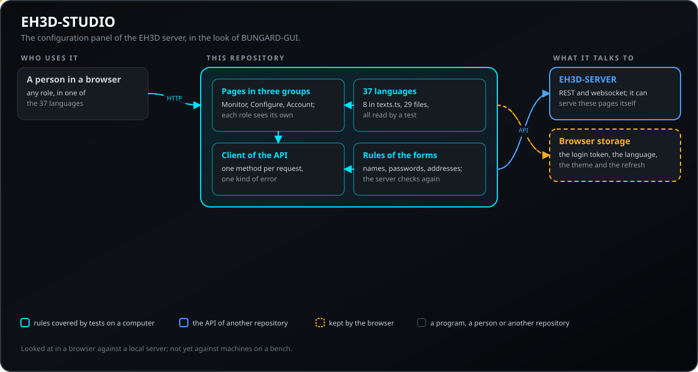
</p>

Cómo encajan las partes de este repositorio: quién habla con él, qué contiene y de qué depende. El dibujo sale de `docs/architecture.json` y se comprueba contra el código.

## 🖼️ Capturas de pantalla

<p align="center">
  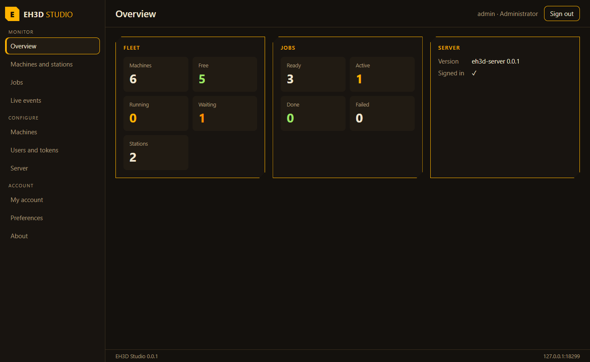
</p>

<p align="center"><em>El resumen: máquinas libres, en marcha y esperando, y los trabajos por estado.</em></p>

<p align="center">
  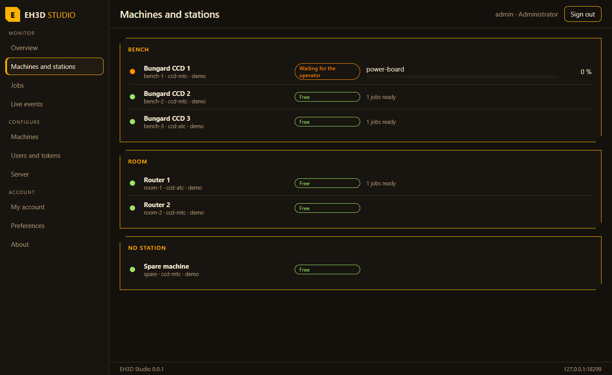
</p>

<p align="center"><em>Las máquinas bajo sus estaciones, con el estado y el progreso de cada trabajo.</em></p>

<p align="center">
  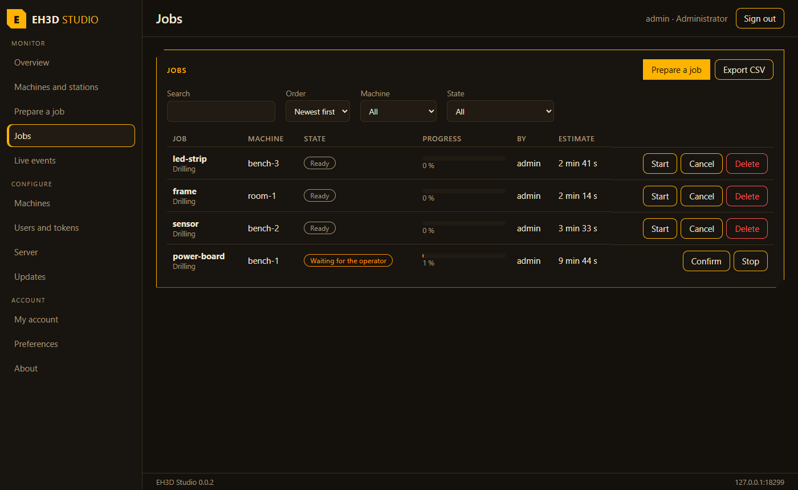
</p>

<p align="center"><em>Los trabajos con sus filtros y las acciones que permite el rol.</em></p>

<p align="center">
  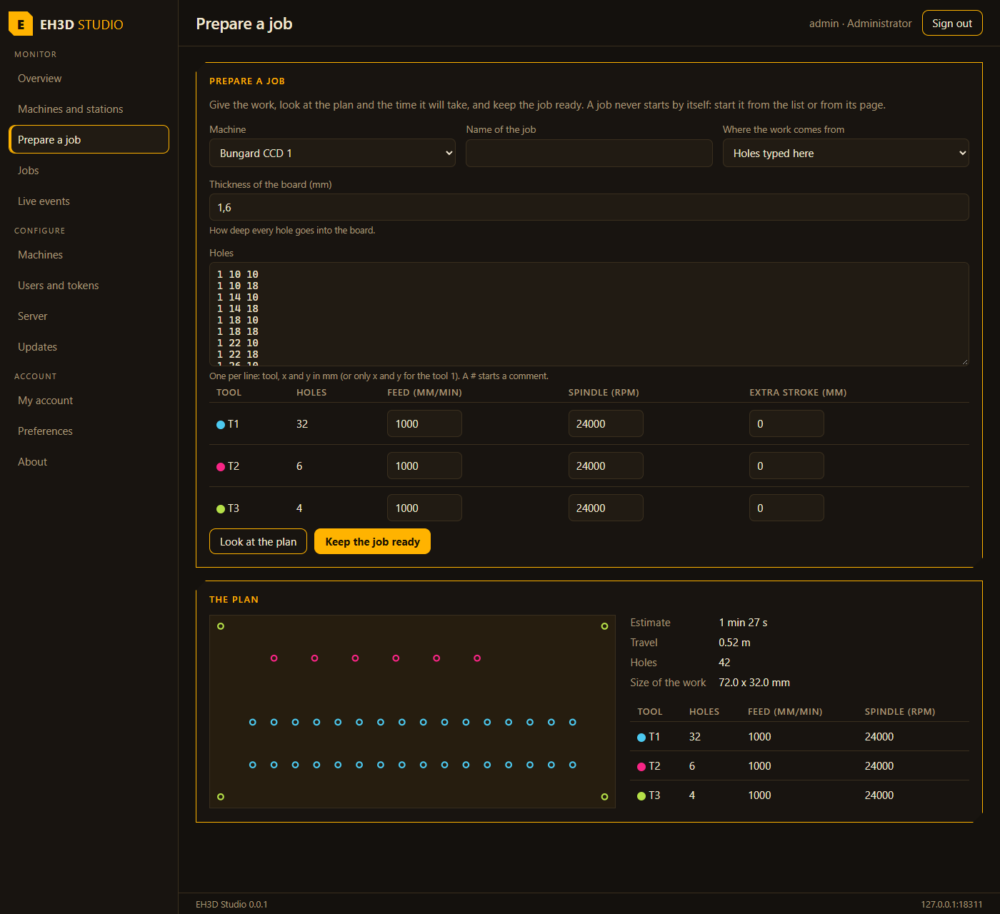
</p>

<p align="center"><em>Preparar un trabajo: el trabajo escrito, el plano y el tiempo que calcula el servidor.</em></p>

<p align="center">
  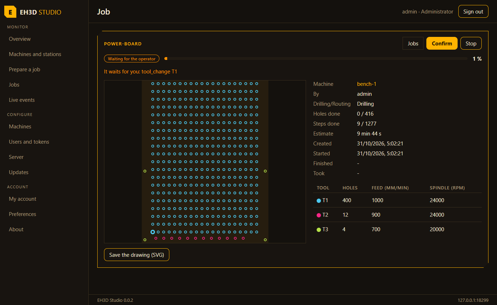
</p>

<p align="center"><em>Un trabajo: el plano con los agujeros ya hechos, cuánto lleva y los botones de su estado.</em></p>

<p align="center">
  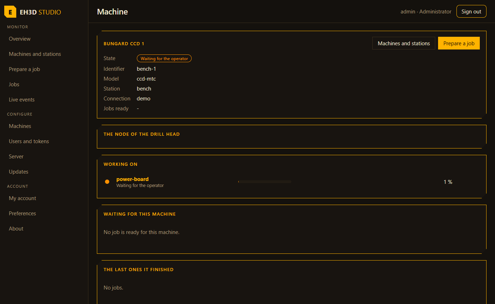
</p>

<p align="center"><em>Una máquina: lo que hace, lo que la espera y los últimos trabajos que terminó.</em></p>

<p align="center">
  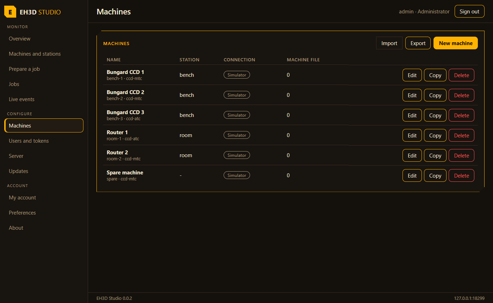
</p>

<p align="center"><em>Las máquinas del servidor: estación, nodo y ficheros de configuración.</em></p>

<p align="center">
  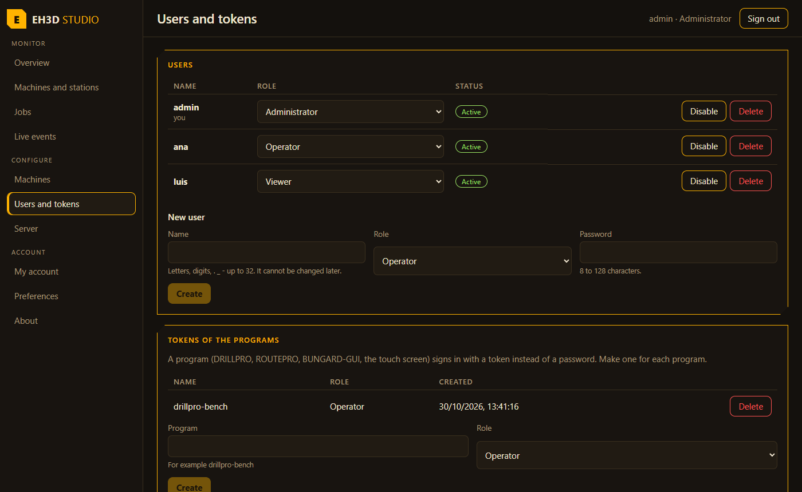
</p>

<p align="center"><em>Los usuarios con su rol, y los tokens de los programas.</em></p>

<p align="center">
  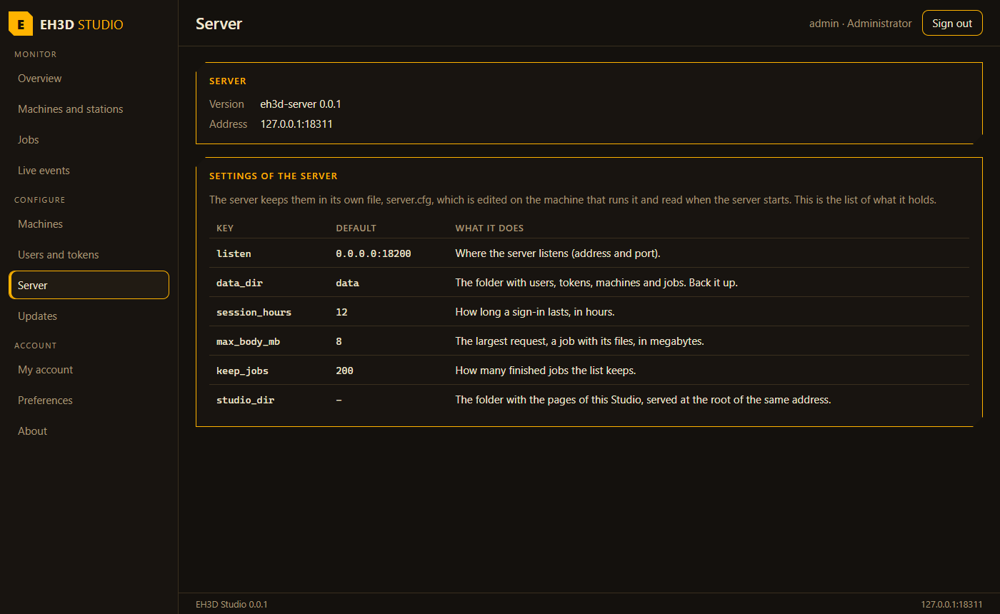
</p>

<p align="center"><em>Los ajustes del servidor, como referencia.</em></p>

<p align="center">
  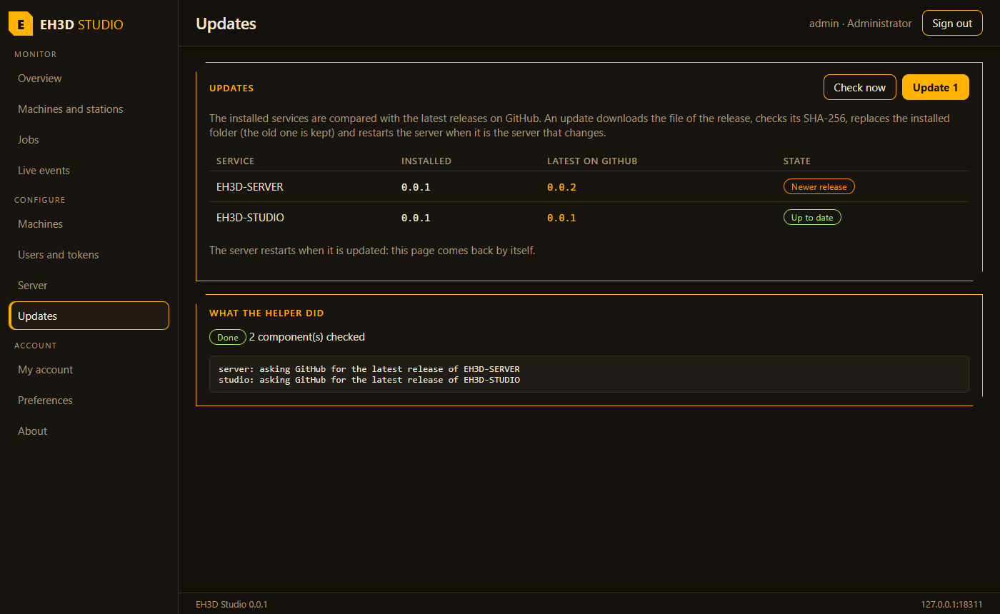
</p>

<p align="center"><em>La página de Actualizaciones: lo instalado, la última versión en GitHub y lo que hizo el ayudante del servidor.</em></p>

<p align="center">
  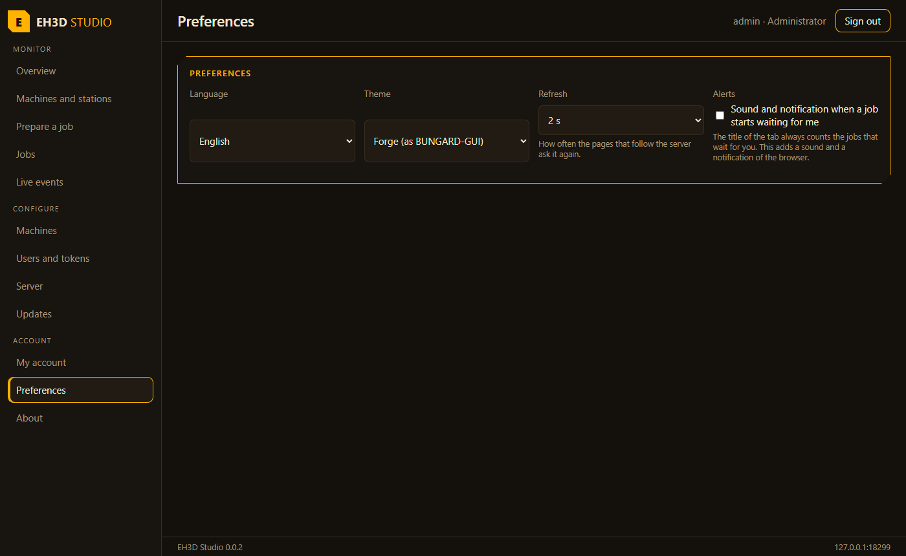
</p>

<p align="center"><em>Las preferencias: idioma, tema y actualización.</em></p>

## ✨ Funciones

* **Cada rol ve su menú:** un observador ve las páginas de Supervisión, la página del Servidor y las de Cuenta; un administrador ve además Máquinas y Usuarios y tokens.
* **Comprobaciones antes de enviar:** los nombres, las contraseñas y las direcciones de nodo se comprueban en el formulario, y la negativa del servidor se muestra como una frase en el idioma de la persona.
* **Tokens que se muestran una vez:** el token de un programa aparece al crearlo y no vuelve a verse; el token de un nodo no se muestra nunca después de guardarlo.
* **Sigue al servidor:** la flota y los trabajos se actualizan solos (o solo cuando se pide), y la página en vivo se reconecta cuando el enlace se cae.
* **Actualizaciones:** una página para el administrador compara el servidor y Studio instalados con las últimas versiones de GitHub, comprueba cuando se pide y actualiza lo que es más nuevo, mostrando lo que hace el ayudante del servidor mientras trabaja; cuando el propio servidor se reinicia, la página vuelve sola. La actualización necesita `updates_dir` en `server.cfg` y el ayudante de EH3D-SERVER instalado; se ha probado con simulaciones de GitHub y systemd, nunca en una instalación real. Un administrador también puede volver a la versión que dejó la última actualización y vaciar el historial de actualizaciones. Cuando la máquina tiene el fichero de firmantes permitidos (`/etc/eh3d-update.signers`), el ayudante solo instala una versión que publique junto a cada fichero un `.sig` válido; esta página no muestra si una versión está firmada.
* **Preparar un trabajo aquí:** elige la máquina y da el trabajo como los ficheros que leen los programas (`.NCD` con su `.DTD`, `.PLT` con su `.RTD`) o como agujeros escritos a mano (herramienta, x e y, con el avance, la velocidad y el recorrido extra de cada herramienta); mira el plano, el tiempo y el recorrido que calcula el servidor, y deja el trabajo listo. Un trabajo nunca arranca solo.
* **Una página para cada trabajo:** el plano con los agujeros ya hechos rellenos y el siguiente rodeado, cuánto lleva, quién lo hizo y cuándo, las herramientas, y los botones que corresponden a su estado (iniciar, confirmar, parar, borrar). Los trabajos que esperan al operador están arriba en el resumen con su botón Confirmar.
* **Iniciar pide una confirmación más:** el botón Iniciar de la página del trabajo, de la lista del Monitor y de la cola de una máquina necesita un segundo toque (el primero cambia el botón a «¿Seguro?» y salir de él lo cancela), para que un toque por error no ponga la máquina en marcha.
* **Una lista con la que se puede trabajar:** búsqueda por nombre, máquina, persona o estado, cinco órdenes, un CSV de lo que se ve y un botón que quita los trabajos terminados; el resumen suma lo que han hecho las máquinas (trabajos, agujeros, horas).
* **Avisos:** el título de la pestaña cuenta los trabajos que esperan al operador y, si la persona lo activa, un sonido y una notificación del navegador avisan cuando uno nuevo empieza a esperar.
* **Las máquinas pasan de un servidor a otro:** cada máquina se puede copiar, y las máquinas de un servidor se pueden exportar a un fichero e importar en otro (los tokens de acceso de los nodos nunca se exportan).
* **Una página para cada máquina, copias y servidor caído:** la página de una máquina muestra lo que hace, los trabajos que la esperan con su tiempo total y los últimos que terminó; un trabajo puede dejarse listo en varias copias a la vez (la misma placa muchas veces); el dibujo de un plano se guarda como SVG; y una línea roja avisa cuando el servidor deja de responder, hasta que vuelve a hacerlo.
* **El nodo del cabezal de taladro en la página de una máquina:** cuando la configuración de la máquina nombra el nodo (`head_address`), la página muestra la velocidad de su husillo, su temperatura con el veredicto del nodo, la salida de protección y el modelo de cámara, un botón que muestra su cámara (MJPEG) y, para un operador, un botón que mide la mesa bajo el cabezal; todo pasa por EH3D-SERVER, que guarda el token del nodo. Probado con un simulado, nunca con un nodo real.
* **El husillo en la página de una máquina:** todos leen qué husillo lleva la máquina (el original o el del variador), qué ocurre con un trabajo que pide más de lo que da, los límites del husillo en uso y la velocidad máxima que poner en el nodo de la máquina; un administrador cambia el husillo y el interruptor de seguridad (rechazar el trabajo, que es el valor por defecto, o avisar y recortar las revoluciones al máximo del husillo). Al preparar un trabajo con el interruptor en `warn`, el plan lista lo que se pasa del husillo, herramienta por herramienta; con `reject` el servidor lo rechaza y Studio dice por qué. No probado con una máquina real.
* **Trabajos G-code libres y máquinas GRBL:** una máquina puede ser un controlador GRBL en un puerto serie del servidor (puerto y velocidad en baudios; el servidor debe compilarse con `--features serial`), y un administrador la da de alta o la cambia en Configuración. En Preparar, un programa G-code (pegado o cargado desde un fichero) se previsualiza y se deja listo como cualquier trabajo, con un interruptor de seguridad para volver a arrancar el husillo y el refrigerante al seguir, apagado por defecto. Un trabajo G-code en marcha se pausa y se reanuda desde la lista, desde su página y desde el resumen, que dicen la línea a la que ha llegado y qué espera (una pausa, o la espera antes del primer movimiento de un trabajo que sigue); un trabajo que se detuvo ofrece seguir desde donde se detuvo: el servidor guardó lo que se pidió, así que no hace falta elegir el archivo otra vez. Los trabajos de taladrado y fresado admiten las herramientas apagadas y los agujeros o trayectorias ya hechos, y la referencia de los ajustes del servidor lista `gcode_finish_wait_s` y `updates_dir`. Probado con el simulador y con un sustituto, nunca con un controlador GRBL real. Un administrador puede permitir por máquina las líneas `$` de GRBL (como `$H`) con un interruptor de seguridad en Configuración, apagado por defecto y con un aviso.
* **El anillo de LEDs y la última comprobación de calidad en la página de una máquina:** un operador enciende o apaga el anillo y fija su nivel y su tono, y todos leen el veredicto de la última comprobación del trabajo. Probado con un sustituto, nunca con un nodo real.
* **Un tiempo máximo en cada petición y tokens que se pueden auditar:** una petición que no recibe respuesta termina como error a los 5 a 60 segundos, una página que pregunta de nuevo espera a la última petición, la lista de tokens de los programas dice cuándo se usó cada uno por última vez y cuándo caduca (marca los que llevan 90 días sin usarse y permite indicar los días que dura un token nuevo), un trabajo dice quién lo inició y quién lo detuvo, la página Servidor muestra los interruptores que informa el servidor en marcha, y cada rechazo del servidor tiene una frase en los 37 idiomas, comprobada contra la lista de códigos que publica el servidor.
* **Los servicios comunes del servidor (sin probar contra el servidor real):** el explorador del almacén de proyectos (árbol, versiones con SHA-256, subida, `.eh3dproj`, bloqueo de edición, conflictos de `If-Match` avisados), las máquinas y trabajos de los plugins con el flujo de eventos, los huecos de herramientas del cambiador, las sesiones y la política del acceso, y los informes de diseño de un proyecto. Cada rol ve y hace solo lo suyo; el servidor decide al final.

## 🔒 Seguridad y protección

| Amenaza | Defensa |
|---|---|
| Alguien que no ha entrado | toda página necesita un acceso; el servidor rechaza toda petición sin un token válido (`401`), y cinco contraseñas erróneas bloquean el nombre un tiempo |
| Una persona que hace más de lo que permite su rol | el menú y los botones siguen el rol, y el servidor vuelve a comprobar el rol en cada petición |
| Un token leído por otra persona | el token de un programa se muestra una vez, el de un nodo nunca más; el token de acceso vive solo en el navegador de la persona (en `sessionStorage`, así que desaparece al cerrar la pestaña; en `localStorage` solo si la persona marca «Recordarme» al entrar) y va solo al servidor del que vino la página |
| Un valor erróneo enviado al servidor | los nombres, contraseñas y direcciones se comprueban antes de enviar, y el servidor los vuelve a comprobar y rechaza una configuración con una clave que no existe |

**Lo que no se defiende:** el servidor aún no termina TLS, así que en una red sin cifrar el token y las contraseñas viajan en claro; un navegador que otra persona puede usar sigue con la sesión abierta hasta que la persona cierra la pestaña (hasta que sale, si «Recordarme» estaba marcado) o la sesión termina (12 horas por defecto). Studio no ha tenido una revisión independiente, y las comprobaciones de un formulario son una comodidad: solo hay que fiarse del servidor.

## 🔌 Interfaces

| Interfaz | Qué es | Dónde |
|---|---|---|
| API REST | todo lo que muestran y cambian las páginas pasa por `/api/v1/` de EH3D-SERVER, con el token de acceso como token portador | `src/api.ts` |
| Websocket | `/api/v1/events?token=...` para la página en vivo, con una reconexión que espera más cada vez | `src/pages/Monitor.tsx` |
| Eventos del servidor | `/api/v1/events/stream` con ticket, `Last-Event-ID` y una reconexión que espera más cada vez | `src/services/events.ts` |
| Almacenamiento del navegador | el token de acceso (`sessionStorage`, o `localStorage` con «Recordarme»), el idioma, el tema y la actualización, bajo `eh3d-studio.*` | `src/App.tsx`, `src/tokenstore.ts` |

## ⚙️ Configuración

Studio no tiene fichero de ajustes propio: los ajustes del servidor están en su `server.cfg` (la página Servidor los lista), y lo que elige una persona se guarda en su navegador.

| Ajuste | Por defecto | Rango | Qué hace |
|---|---|---|---|
| `studio_dir` | none | a folder | en `server.cfg` del servidor: sirve las páginas de esta carpeta en su raíz |
| `EH3D_SERVER` | `http://127.0.0.1:18200` | a URL | al desarrollar (`run.sh`): el servidor con el que hablan las páginas |
| `eh3d-studio.lang` | the browser's | `en es it de fr pt zh ja bg hr cs da nl et fi el hu ga lv lt mt pl ro sk sl sv no is uk ru sr sq ca gl eu pt-br fr-ca` | el idioma de la página |
| `eh3d-studio.theme` | `forge` | `forge paper neon midnight` | el tema de la página |
| `eh3d-studio.refresh` | 5 | 0, 2, 5, 10, 30 | segundos entre dos lecturas del servidor (0: solo cuando se pide) |

## 🚀 Inicio rápido

Necesitas Node 22 o más reciente. Para usar Studio en la CM5, compila las páginas y dile al servidor dónde están.

```bash
build.bat            # install and build the pages into dist/  -  ./build.sh on Linux
test.bat             # type check, lint and tests
python -I tools/ci_validate.py
```

Copia `dist/` a la CM5 (por ejemplo a `/opt/eh3d-studio`), pon `studio_dir = /opt/eh3d-studio` en el `server.cfg` del servidor y reinícialo: Studio se abre en la dirección del servidor, por ejemplo `http://cm5:18200/`. La primera vez, la página pide el código de alta que el servidor muestra en su consola y crea el administrador.

## 🧪 Pruebas

`npm test` ejecuta 323 pruebas y pasan todas: el cliente de la API (el token, el cuerpo, la consulta, los errores, una red que falla, las rutas con nombres que necesitan escape), las reglas de nombres, contraseñas y direcciones de nodo, lo que está mal en una máquina, el menú de cada rol, las máquinas agrupadas por estación, los recuentos y las acciones de un trabajo, y los 37 idiomas (cada idioma tiene todos los textos, los mismos marcadores en todas partes, las dos variantes solo con claves de la fuente, chino y japonés en su escritura, ninguno escrito de derecha a izquierda). `npm run typecheck` y `npm run lint` también pasan. También lee los ejemplos de respuestas que hacen las pruebas del servidor, de modo que una respuesta que cambia sin que Studio la siga falla aquí. También prueba el tiempo máximo de cada petición (con un reloj que se mueve a mano), el sondeo que espera a la última petición, los textos frente al catálogo de códigos de error del servidor y las reglas de los tokens de los programas.

## 🏗️ Compilación y publicación

La versión vive en `package.json` y en `eh3d.project.json`, y cada versión tiene su entrada en [CHANGELOG.md](CHANGELOG.md). `build.sh` / `build.bat` instalan lo necesario la primera vez y compilan las páginas en `dist/`; `test.sh` / `test.bat` ejecutan la comprobación de tipos, el lint y las pruebas; `run.sh` / `run.bat` abren Studio en desarrollo contra un servidor (`run.sh http://cm5:18200`).

## 🩺 Resolución de problemas

| Síntoma | Qué hacer |
|---|---|
| La página dice que el servidor no responde | Abre `http://DIRECCIÓN/api/v1/health` en el navegador: debe responder `eh3d-server` y una versión. Si el servidor sirve Studio, la dirección de la página es la del servidor. |
| La página pide un código de alta | El servidor aún no tiene usuarios: el código está en su consola (en la CM5: `journalctl -u eh3d-server`). |
| Una página que necesito no está en el menú | El menú sigue el rol: las máquinas y los usuarios y tokens son para administradores. |
| Guardar una máquina se rechaza con un error de configuración | El fichero de máquina tiene una clave que no existe o un valor fuera de rango; el servidor lo rechaza en lugar de ignorarlo. |

## 📂 Estructura del repositorio

<p align="center">
  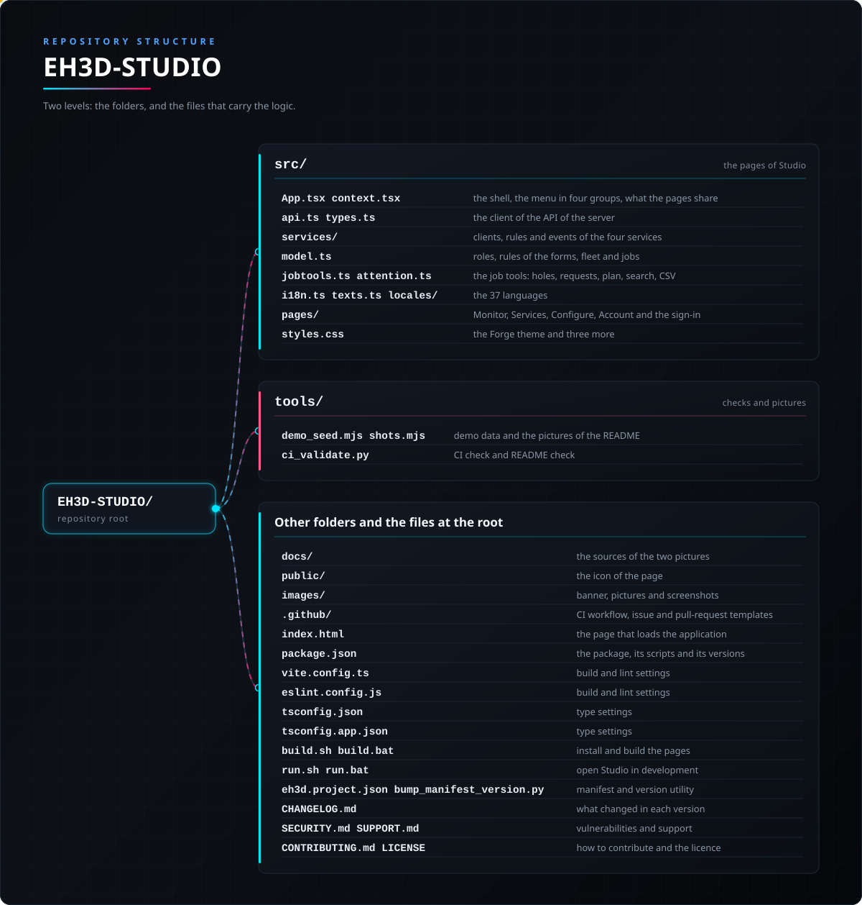
</p>

<details>
<summary>Versión en texto del árbol</summary>

```text
EH3D-STUDIO/
├── src/
│   ├── App.tsx context.tsx                      el armazón, el menú en cuatro grupos, lo que comparten las páginas
│   ├── api.ts types.ts                          el cliente de la API del servidor
│   ├── services/                                clientes, reglas y eventos de los cuatro servicios
│   ├── model.ts                                 roles, reglas de los formularios, flota y trabajos
│   ├── jobtools.ts attention.ts                 las herramientas de trabajos: agujeros, peticiones, plano, búsqueda, CSV
│   ├── tokenstore.ts                            dónde se guarda el token de acceso: esta pestaña, o el navegador si se recuerda
│   ├── i18n.ts texts.ts locales/                los 37 idiomas
│   ├── pages/                                   Supervisión, Servicios, Configuración, Cuenta y el acceso
│   └── styles.css                               el tema Forge y tres más
├── tools/
│   ├── demo_seed.mjs shots.mjs                  datos de demostración y las imágenes del README
│   └── ci_validate.py                           comprobación de CI y de README
├── docs/                                        las fuentes de los dos dibujos
├── public/                                      el icono de la página
├── images/                                      banner, dibujos y capturas
├── .github/                                     flujo de CI y plantillas
├── index.html                                   la página que carga la aplicación
├── package.json                                 el paquete, sus scripts y sus versiones
├── vite.config.ts                               ajustes de compilación y lint
├── eslint.config.js                             ajustes de compilación y lint
├── tsconfig.json                                ajustes de tipos
├── tsconfig.app.json                            ajustes de tipos
├── build.sh build.bat                           instalar y compilar las páginas
├── run.sh run.bat                               abrir Studio en desarrollo
├── eh3d.project.json bump_manifest_version.py   manifiesto y utilidad de versión
├── CHANGELOG.md                                 qué cambió en cada versión
├── SECURITY.md SUPPORT.md                       vulnerabilidades y soporte
└── CONTRIBUTING.md CODE_OF_CONDUCT.md LICENSE   cómo contribuir y la licencia
```

</details>

## 🗺️ Hoja de ruta y límites conocidos

**Límites conocidos hoy**

* No se ha usado con máquinas en un banco: no se ha configurado a través de ella ninguna máquina de un taller ni se ha ejecutado desde ella ningún trabajo en una máquina real.
* El servidor no termina TLS, así que el token y las contraseñas viajan en claro en una red sin cifrar.
* Los ajustes del servidor se muestran como referencia, no se editan: la API no los entrega, y se cambian en `server.cfg` en la máquina que ejecuta el servidor.
* Solo el dueño ha mirado las páginas; los textos de los idiomas distintos del inglés no los han leído hablantes nativos.
* Todavía no hay página del visor de un trabajo (el plano de los agujeros).
* Las páginas de los servicios comunes solo se han ejecutado contra un sustituto del servidor; las rutas que ahora usan para la ejecución del diseño, la auditoría, las claves, los cambios de la política y la cuota están escritas a partir del contrato de EH3D-SERVER y no se han probado contra un servidor en marcha. La ejecución del diseño necesita que el servidor esté preparado para ello (si no, responde 501) y no se ha probado con el programa de diseño real.

**Siguiente**

* Probarla con las máquinas de un banco: añadir cada máquina, llegar a su nodo y ejecutar un trabajo desde la página de trabajos.
* Una página para ver un trabajo (el plano de los agujeros y por dónde va).
* Terminar TLS en el servidor, o documentar un proxy inverso, y mostrar el estado de la conexión.
* Editar los ajustes del servidor desde Studio cuando el servidor los entregue.

## 🌍 Idiomas

Las páginas hablan 37 idiomas: los ocho primeros (inglés, español, italiano, alemán, francés, portugués de Portugal, chino y japonés) y 29 más. El README existe en los ocho primeros; las palabras de los otros 29 son traducciones del modelo pendientes de revisión por hablantes nativos.

El idioma se elige en este orden: el guardado en el navegador (el selector de la página de acceso y de Preferencias, una lista con desplazamiento que muestra cada idioma con su propio nombre), el idioma del navegador (Brasil da portugués de Brasil, Canadá da francés de Canadá, `nb` y `nn` dan noruego) y por último inglés. Un texto que un idioma no tiene se toma del idioma principal de una variante, luego del inglés y luego del español. Ninguno de los 37 se escribe de derecha a izquierda, así que Studio no tiene diseño de derecha a izquierda.

| Código | Idioma | Código | Idioma | Código | Idioma |
|---|---|---|---|---|---|
| `en` | English | `es` | Español | `it` | Italiano |
| `de` | Deutsch | `fr` | Français | `pt` | Português (Portugal) |
| `zh` | 中文 | `ja` | 日本語 | `bg` | Български |
| `hr` | Hrvatski | `cs` | Čeština | `da` | Dansk |
| `nl` | Nederlands | `et` | Eesti | `fi` | Suomi |
| `el` | Ελληνικά | `hu` | Magyar | `ga` | Gaeilge |
| `lv` | Latviešu | `lt` | Lietuvių | `mt` | Malti |
| `pl` | Polski | `ro` | Română | `sk` | Slovenčina |
| `sl` | Slovenščina | `sv` | Svenska | `no` | Norsk |
| `is` | Íslenska | `uk` | Українська | `ru` | Русский |
| `sr` | Српски | `sq` | Shqip | `ca` | Català |
| `gl` | Galego | `eu` | Euskara | `pt-br` | Português (Brasil) |
| `fr-ca` | Français (Canada) |  |  |  |  |

## 🔗 Proyectos relacionados

* [EH3D-SERVER](https://github.com/JuanenRac/EH3D-SERVER): el servidor que configura este panel
* [EH3D-DRILLPRO](https://github.com/JuanenRac/EH3D-DRILLPRO): el programa de taladrado, cliente del servidor
* [EH3D-ROUTEPRO](https://github.com/JuanenRac/EH3D-ROUTEPRO): el programa de fresado, cliente del servidor
* [EH3D-BUNGARD-GUI](https://github.com/JuanenRac/EH3D-BUNGARD-GUI): la interfaz moderna de las máquinas Bungard, con una ventana de máquinas y estaciones
* [EH3D-NODE-BUNGARD-HMI](https://github.com/JuanenRac/EH3D-NODE-BUNGARD-HMI): la pantalla táctil de la máquina, un cliente más del servidor
* [EH3D-BUNGARD-GUI](https://github.com/JuanenRac/EH3D-BUNGARD-GUI): el aspecto que sigue este panel

## 📚 Documentación

* La API del servidor con el que habla Studio: `docs/API.md` de EH3D-SERVER.
* Cómo poner el servidor y Studio en la CM5: `docs/DEPLOY.md` de EH3D-SERVER.
* Páginas de los servicios comunes: [proyectos](docs/PROJECTS_AND_FILES.md), [máquinas y trabajos](docs/MACHINES_AND_JOBS.md), [seguridad](docs/USERS_AND_SECURITY.md), [diseño y fábrica](docs/DESIGN_AND_FACTORY.md) y [lo que haría falta en el servidor](docs/DESIGN_FACTORY_CONTRACT_NEEDS.md).
* [Registro de cambios](CHANGELOG.md)

## 🤝 Contribuir y comunidad

* Antes de una pull request ejecuta `npm run typecheck`, `npm run lint`, `npm test` y `npm run build`, y `python -I tools/ci_validate.py`: todo debe pasar. Mira [CONTRIBUTING.md](CONTRIBUTING.md) y el [código de conducta](CODE_OF_CONDUCT.md).
* El README existe en ocho idiomas: un cambio del texto se hace en los ocho ficheros, y los dos dibujos salen de `docs/architecture.json` y `docs/structure.json` con `tools/make_architecture.py` y `tools/make_structure.py`.
* Los ocho primeros idiomas son una fila de ocho por texto en `src/texts.ts`; los otros 29 son un fichero JSON cada uno en `src/locales/` (`pt-br` y `fr-ca` solo llevan lo que difiere de `pt` y `fr`); una prueba lee cada texto de cada idioma.
* Informa de una vulnerabilidad en privado: [SECURITY.md](SECURITY.md). Preguntas, ideas e informes: electrohobby3d@gmail.com ([SUPPORT.md](SUPPORT.md)).

## 👤 AUTOR

**JuanenRac (Electro Hobby 3D)** · electrohobby3d@gmail.com

## 📜 LICENCIA

Software: GPL-3.0-or-later. Véase [LICENSE](LICENSE). Los diseños de hardware de la suite usan CERN OHL-S.
